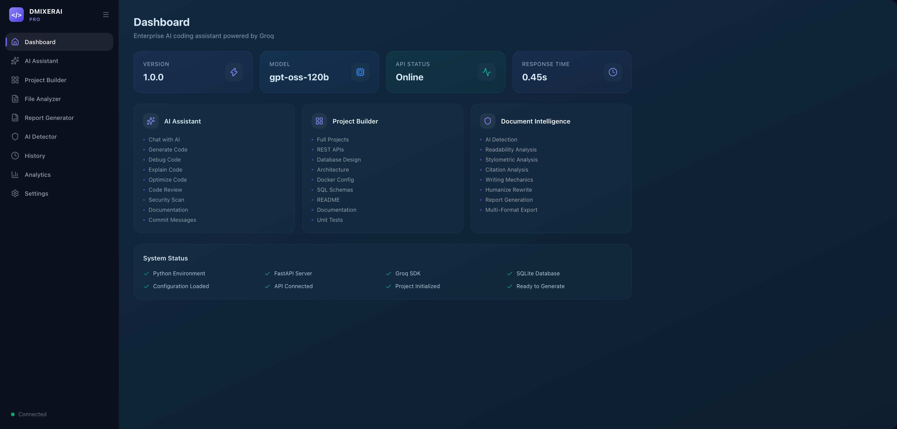
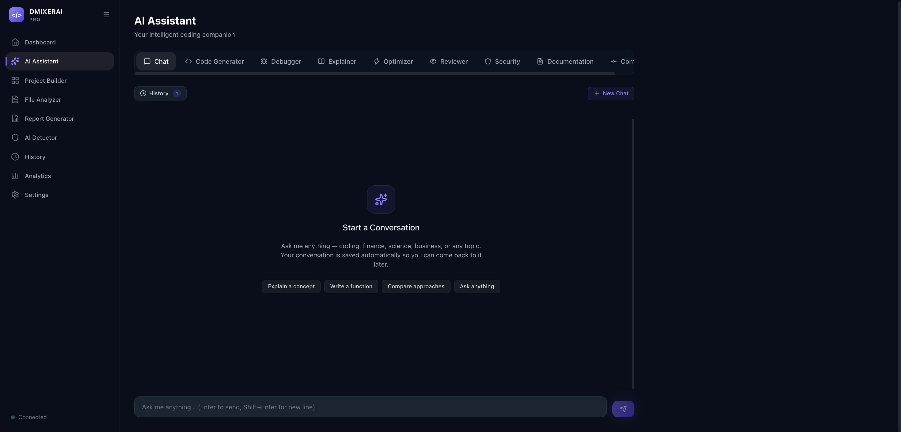
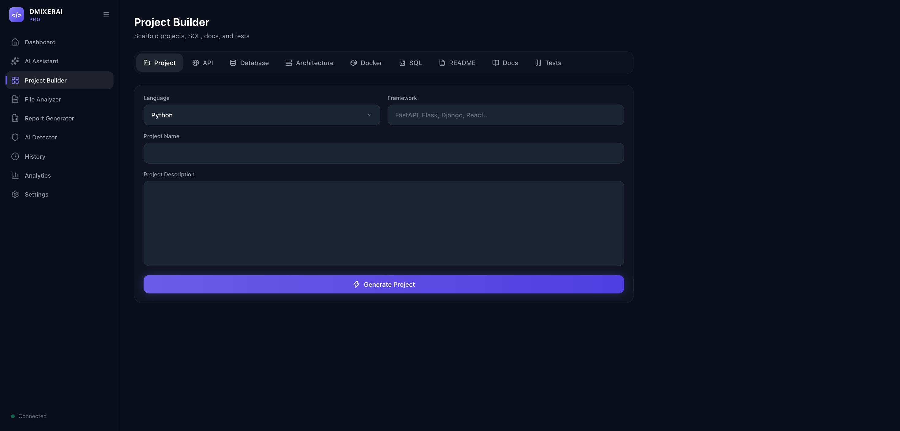
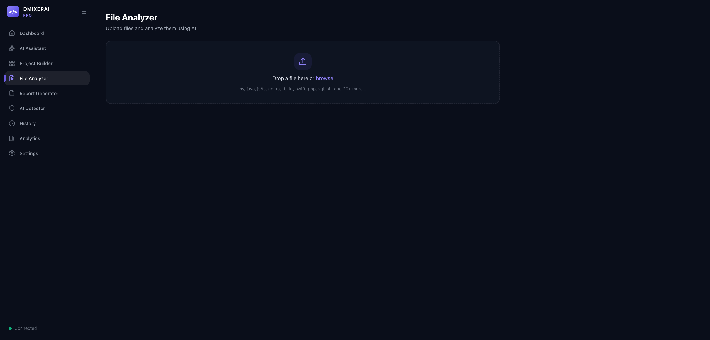
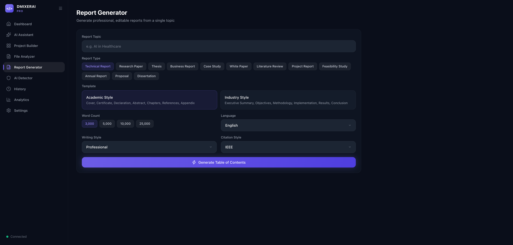
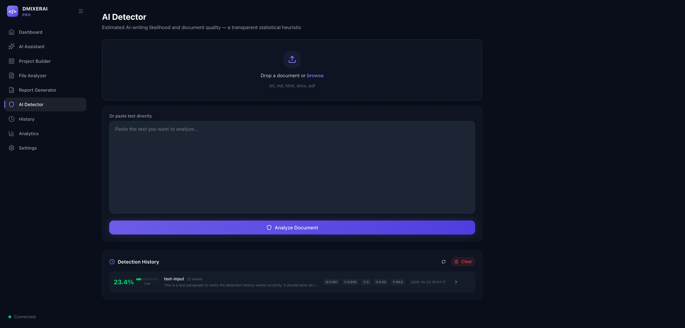
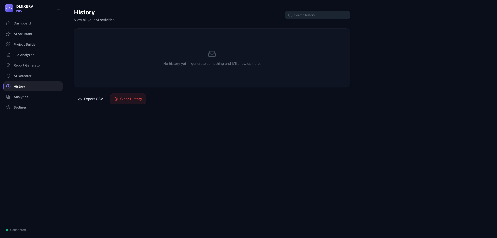
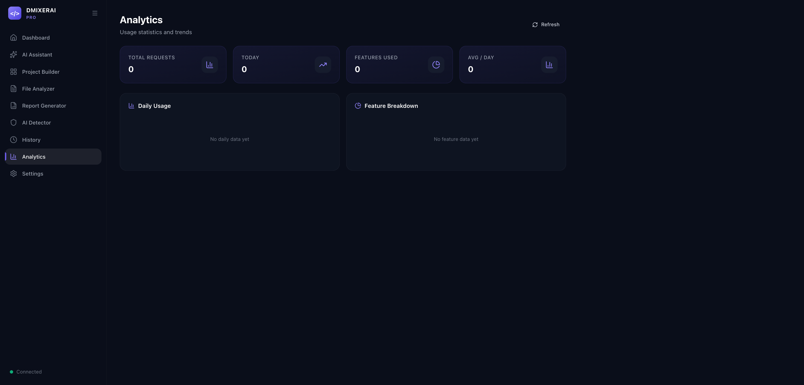
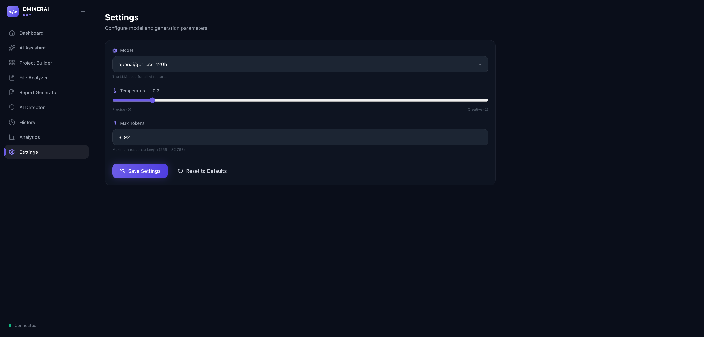

# DMIXERAI

A full-stack AI assistant powered by **Groq LLM**. Built with a **FastAPI**
backend and a modern **React 18** frontend (Vite + Tailwind CSS v4 + Framer
Motion + Recharts).

It covers the entire software development lifecycle — from code generation
and debugging to project scaffolding, report writing, AI content detection,
and more — all through a sleek dark-themed UI.

---

## Screenshots

| Dashboard | AI Assistant |
|:-:|:-:|
|  |  |

| Project Builder | File Analyzer |
|:-:|:-:|
|  |  |

| Report Generator | AI Detector |
|:-:|:-:|
|  |  |

| History | Analytics |
|:-:|:-:|
|  |  |

| Settings |
|:-:|
|  |

---

## Table of Contents

- [Features](#features)
- [Tech Stack](#tech-stack)
- [Setup](#setup)
- [Running the App](#running-the-app)
- [Project Structure](#project-structure)
- [API Reference](#api-reference)
- [AI Detection Methodology](#ai-detection-methodology)
- [Troubleshooting](#troubleshooting)

---

## Features

### Dashboard
Live Groq API status, current model, response time, and system health
overview with animated metric cards.

### AI Assistant (9 tools)
- **Chat** — Multi-turn streaming conversations with full context memory.
  Previous chats are saved and can be resumed anytime.
- **Code Generator** — Describe a task → production-ready code with optional tests
- **Debugger** — Paste code → severity-ranked bug list + corrected code
- **Explainer** — Structured explanation at Beginner / Intermediate / Advanced depth
- **Optimizer** — Optimize for performance, readability, security, etc.
- **Reviewer** — PR-style code review with verdict + ranked issues
- **Security Scanner** — Vulnerability scan with attack scenarios
- **Documentation** — Auto-generate docstrings and doc-comments
- **Commit Generator** — Generate Conventional Commits messages from diffs

### Project Builder (9 tools)
- **Project Scaffold** — Full folder structure, files, dependencies → downloadable **ZIP**
- **API Generator** — REST API design + implementation → ZIP
- **Database Designer** — ER model with Mermaid diagram
- **Architecture** — System architecture with trade-offs + Mermaid diagram
- **Docker** — Dockerfile + docker-compose.yml
- **SQL** — Schema for PostgreSQL / MySQL / SQLite / SQL Server
- **README** — Auto-generated README.md
- **Documentation** — Professional docs from project description
- **Unit Tests** — Tests with mocked externals and edge cases

### File Analyzer
Upload source files (30+ languages) and run: Explain / Debug / Optimize /
Documentation / Security Scan / Complexity Analysis.

### Report Generator
Generate full multi-chapter reports (12 types) with:
- AI-generated Table of Contents (fully editable with drag-and-drop)
- Chapter-by-chapter generation with real progress tracking
- Per-chapter editing (Expand, Shorten, Rewrite, Simplify, Humanize, etc.)
- Export as **DOCX**, **PDF**, or **Markdown**
- Auto-saves to localStorage

### AI Detector
Upload text or documents for AI-writing analysis:
- **10-signal heuristic ensemble** for AI probability scoring
- **12 stylometric metrics** (burstiness, vocabulary, contractions, hapax, etc.)
- **6 readability indices** (Flesch, Gunning Fog, SMOG, etc.)
- Citation analysis, writing mechanics, paragraph breakdown
- **AI Insights** — LLM narrative grounded in real computed data
- **Humanize** — Style-naturalization rewrite with 8 techniques
- **Detection History** — All analyses saved with 24 metric columns
- Export as PDF, DOCX, Markdown, JSON, or CSV

### History & Analytics
- Searchable generation history with CSV export
- Usage analytics with bar and donut charts
- Persisted in SQLite — survives restarts

### Settings
- Model selector, temperature slider, max tokens
- Stored in localStorage per browser

---

## Tech Stack

### Frontend

| Technology | Purpose |
|---|---|
| React 18 | UI framework |
| Vite 8 | Build tool with HMR |
| Tailwind CSS v4 | Utility-first CSS with custom `@theme` tokens |
| Framer Motion | Animations and page transitions |
| Recharts | Charts (bar, pie, area) |
| React Router v7 | Client-side routing |
| Lucide React | Icons |
| react-hot-toast | Toast notifications |

### Backend

| Technology | Purpose |
|---|---|
| FastAPI | REST API framework |
| Uvicorn | ASGI server |
| Groq SDK | LLM API client |
| SQLite | Local database (3 tables) |
| python-docx | DOCX export |
| ReportLab | PDF export |

### Design

- Custom dark theme with purple/violet primary palette
- Glass-morphism card components with backdrop blur
- Responsive layout with collapsible sidebar
- CSS animations + Framer Motion micro-interactions

---

## Setup

### Prerequisites

- **Python 3.9+**
- **Node.js 18+**
- **Groq API Key** — [Get one free](https://console.groq.com/keys)

### 1. Clone the repository

```bash
git clone https://github.com/YOUR_USERNAME/DMIXERAI.git
cd DMIXERAI
```

### 2. Backend setup

```bash
python3 -m venv .venv
source .venv/bin/activate        # Windows: .venv\Scripts\activate
pip install -r requirements.txt
```

### 3. Frontend setup

```bash
cd frontend
npm install
npm run build
cd ..
```

### 4. Configure environment

```bash
cp .env.example .env
```

Edit `.env` and add your Groq API key:

```env
GROQ_API_KEY=your_groq_api_key_here
MODEL_NAME=openai/gpt-oss-120b
APP_NAME=DMIXERAI
VERSION=2.0.0
```

---

## Running the App

### Production

```bash
source .venv/bin/activate
uvicorn main:app --reload
```

Open **http://localhost:8000** in your browser.

### Frontend development (hot reload)

```bash
cd frontend
npm run dev
```

Vite dev server starts on port 5173 with API proxy to port 8000.

---

## Project Structure

```
DMIXERAI/
├── main.py                        FastAPI app: routes + static serving
├── config.py                      Environment config loader
├── requirements.txt               Python dependencies
├── .env.example                   Environment template
│
├── frontend/                      React frontend (source)
│   ├── package.json
│   ├── vite.config.js
│   ├── index.html
│   └── src/
│       ├── App.jsx                Router (9 routes + catch-all)
│       ├── main.jsx               Entry point
│       ├── styles/index.css       Tailwind v4 theme + components
│       ├── components/            Layout + UI components
│       ├── contexts/              Settings context provider
│       ├── pages/                 9 page components
│       └── utils/api.js           API client
│
├── static-react/                  Production build output
├── static/                        Legacy frontend (fallback)
│
├── services/
│   ├── groq_client.py             Groq API wrapper
│   ├── database.py                SQLite (history, analytics, detector_history)
│   ├── text_analysis.py           10-signal AI detection engine
│   ├── readability.py             Flesch / Flesch-Kincaid computation
│   ├── document_extract.py        Text extraction (txt/md/html/docx/pdf)
│   ├── report_export.py           DOCX/PDF export
│   ├── file_handler.py            Source file extraction
│   ├── prompts.py                 System prompt
│   └── logger.py                  File logger
│
└── screenshots/                   App screenshots
```

---

## API Reference

All endpoints prefixed with `/api`. Full details below.

### Core
| Method | Path | Description |
|---|---|---|
| GET | `/api/status` | Connection status + model info |
| GET | `/api/models` | Available models |
| POST | `/api/chat` | Streaming chat with conversation history |

### AI Assistant
| Method | Path | Action |
|---|---|---|
| POST | `/api/code/generate` | Generate code |
| POST | `/api/code/debug` | Debug code |
| POST | `/api/code/explain` | Explain code |
| POST | `/api/code/optimize` | Optimize code |
| POST | `/api/code/review` | Review code |
| POST | `/api/code/security` | Security scan |
| POST | `/api/code/document` | Generate docs |
| POST | `/api/code/commit` | Generate commit message |

### Project Builder
| Method | Path | Action |
|---|---|---|
| POST | `/api/project/generate` | Scaffold project |
| POST | `/api/project/zip` | Download as ZIP |
| POST | `/api/project/api` | Generate API |
| POST | `/api/project/database` | Design database |
| POST | `/api/project/architecture` | Design architecture |
| POST | `/api/project/docker` | Generate Docker config |
| POST | `/api/project/sql` | Generate SQL schema |
| POST | `/api/project/readme` | Generate README |
| POST | `/api/project/docs` | Generate documentation |
| POST | `/api/project/tests` | Generate tests |

### File Analyzer
| Method | Path |
|---|---|
| POST | `/api/file/analyze` (multipart: `action` + `file`) |

### Report Generator
| Method | Path | Action |
|---|---|---|
| POST | `/api/report/toc` | Generate table of contents |
| POST | `/api/report/chapter` | Generate chapter |
| POST | `/api/report/edit` | Edit chapter |
| POST | `/api/report/references` | Generate references |
| POST | `/api/report/readability` | Compute readability |
| POST | `/api/report/export/{format}` | Export (markdown/docx/pdf) |

### AI Detector
| Method | Path | Action |
|---|---|---|
| POST | `/api/detect/analyze/text` | Analyze text (instant) |
| POST | `/api/detect/analyze/file` | Analyze file |
| POST | `/api/detect/insights` | AI-generated insights |
| POST | `/api/detect/humanize` | Humanize text |
| POST | `/api/detect/export/{format}` | Export report |
| GET | `/api/detect/history` | Detection history |
| GET | `/api/detect/history/{id}` | Full analysis for entry |
| DELETE | `/api/detect/history/{id}` | Delete entry |
| DELETE | `/api/detect/history` | Clear all history |

### History & Analytics
| Method | Path | Action |
|---|---|---|
| GET | `/api/history` | All history |
| DELETE | `/api/history` | Clear history |
| GET | `/api/history/export` | Export CSV |
| GET | `/api/analytics` | Usage stats |
| DELETE | `/api/analytics` | Reset analytics |

---

## AI Detection Methodology

The AI detector uses a **10-signal weighted heuristic ensemble** — not a
trained classifier. Each signal is computed directly from the text:

| Signal | Weight | What it detects |
|---|---|---|
| Low burstiness | 0.16 | Uniform sentence lengths |
| Low vocabulary richness | 0.12 | Low type-token ratio |
| Repetition | 0.10 | Repeated n-grams |
| Low contraction use | 0.10 | Formal writing without contractions |
| Low hapax ratio | 0.10 | Few unique words |
| AI phrase density | 0.10 | Known AI phrases ("delve into", "it is important to note") |
| Transition uniformity | 0.08 | Low transition diversity |
| Paragraph uniformity | 0.08 | Similar paragraph lengths |
| Consecutive similar sentences | 0.08 | Adjacent sentences with similar length |
| Low opener diversity | 0.08 | Repetitive sentence starters |

**Short-text dampening:** Texts under 100 words are dampened by 0.6×,
under 250 words by 0.8×, to reduce false positives.

All weights, thresholds, and raw values are transparent and shown in the UI.
See [`services/text_analysis.py`](services/text_analysis.py) for the full
implementation.

---

## Troubleshooting

| Problem | Solution |
|---|---|
| `GROQ_API_KEY not found` | Add your key to `.env` |
| Dashboard shows "Offline" | Check API key, internet, or Groq rate limits |
| `429 rate_limit_exceeded` | Daily Groq token cap reached — wait or switch models |
| `ModuleNotFoundError` | Run `source .venv/bin/activate && pip install -r requirements.txt` |
| Port in use | Use `--port 8080` or kill existing process |
| Blank page | Run `cd frontend && npm install && npm run build` |
| Build fails | Ensure Node.js 18+ is installed |

---

## License

This project is open source and available under the [MIT License](LICENSE).
